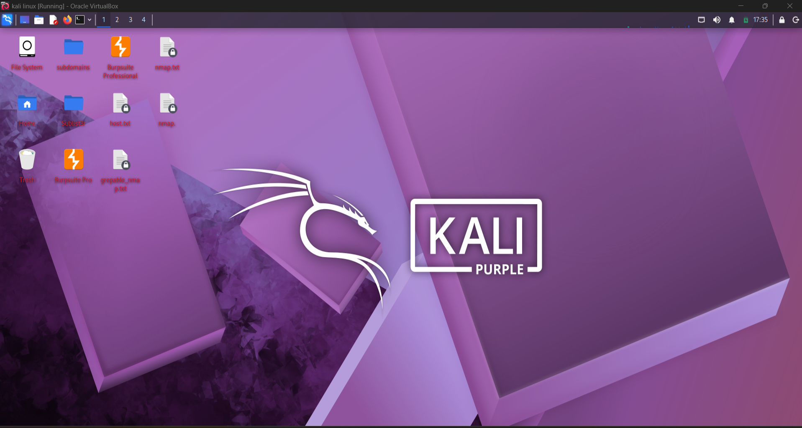
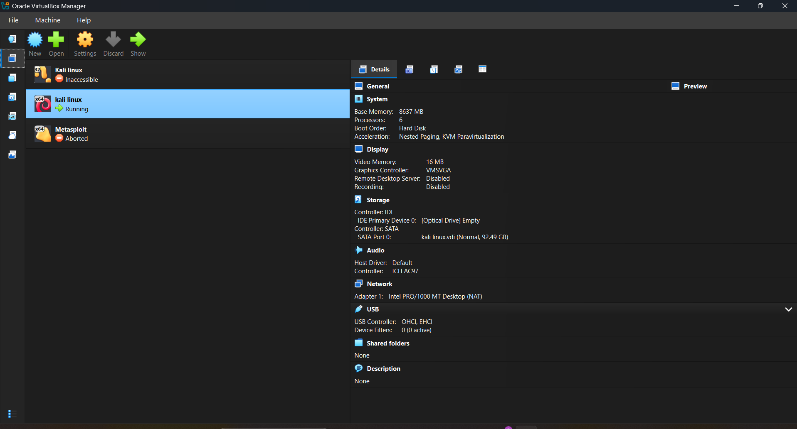
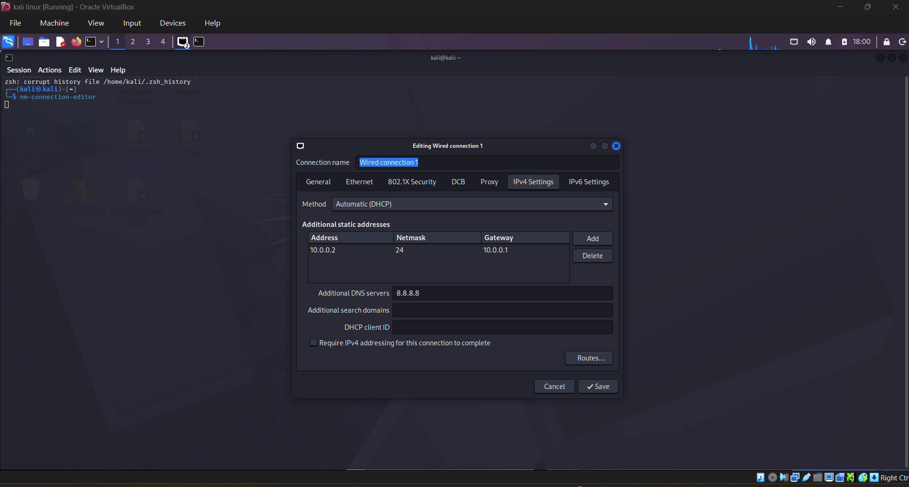
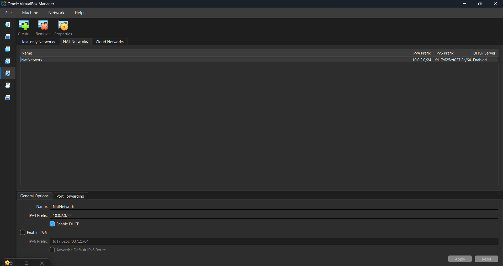

<div align="center">

# 🛡️ KALI LINUX CYBERSECURITY LAB

### VirtualBox-Based Cybersecurity Lab Environment

**Prepared by: Omjee Ojha**

BTech/MTech Integrated CSE  
Specialization: Cybersecurity

</div>

---

# 🏗️ Lab Architecture


> **Note:** The architecture image is an overview. Confirm IP address, DNS, storage, and other network values against your actual VirtualBox/Kali configuration before relying on them.

---

# 📌 Project Overview

This repository documents the setup of a personal cybersecurity learning lab using Oracle VM VirtualBox and Kali Linux on a Windows 11 host machine.

The lab is intended for learning Linux, networking, virtualization, reconnaissance, and security testing in a controlled environment.

# 🎯 Objectives

- Install and configure Oracle VM VirtualBox.
- Set up Kali Linux as a virtual machine.
- Understand virtual machine resources and snapshots.
- Configure and understand NAT networking.
- Practice basic Linux terminal commands.
- Learn IP addressing, routing, and DNS.
- Explore cybersecurity tools in authorized lab environments.
- Document setup steps, screenshots, and learning outcomes.

# 💻 Lab Environment

| Component | Configuration |
|---|---|
| Host operating system | Windows 11 |
| Laptop | Dell G15 |
| Processor | Intel Core i5-13450HX |
| Host RAM | 16 GB |
| Virtualization software | Oracle VM VirtualBox |
| Guest operating system | Kali Linux |
| RAM allocated to VM | 8 GB |
| Network mode | NAT (current configuration) |

> Update this table if any of your actual VM settings differ. Do not publish example IP addresses as if they are verified values.

# 🧩 Virtual Machine Setup

1. Install Oracle VM VirtualBox on the Windows host.
2. Download the official Kali Linux installer image.
3. Create a new virtual machine and attach the Kali ISO.
4. Allocate suitable RAM, CPU cores, and virtual disk space.
5. Complete the Kali Linux installation.
6. Configure the VM network adapter.
7. Boot Kali Linux and verify that the system works.

# 🌐 Network Configuration

The current VirtualBox network adapter is configured for **NAT**.

NAT allows the Kali virtual machine to access external networks through the host's network connection. The guest normally receives its network configuration through DHCP.

Useful commands to inspect the actual configuration:

```bash
ip a
ip route
cat /etc/resolv.conf
```

To test connectivity:

```bash
ping -c 4 8.8.8.8
ping -c 4 google.com
```

Record the actual IP address, default gateway, and DNS server from your own VM output if you want to include them in this documentation.

# 📸 Setup Screenshots

### Kali Linux Desktop



### VirtualBox VM Snapshot



### Kali Network Settings



### VirtualBox Network Settings



# 🛠️ Tools and Technologies

- Oracle VM VirtualBox
- Kali Linux
- Linux Terminal
- Nmap
- Burp Suite
- Wireshark

Tools listed here are part of the lab/toolkit learning scope; document a tool as installed only after verifying it on your VM.

# 📚 Learning Outcomes

Through this lab, I am working on:

- Understanding virtualization and guest operating systems.
- Using the Linux command line.
- Understanding NAT and basic network communication.
- Inspecting IP addresses, routes, and DNS settings.
- Building a repeatable environment for cybersecurity practice.
- Recording technical work clearly with screenshots and notes.

# 🔐 Security and Ethics

All scanning, reconnaissance, and security testing must be performed only against systems that I own or have explicit permission to assess. This lab is intended for legal and authorized learning.

# 👤 Author

**Omjee Ojha**  
BTech/MTech Integrated CSE  
Specialization: Cybersecurity

---

<div align="center">

**Build · Learn · Practice · Grow**

</div>
